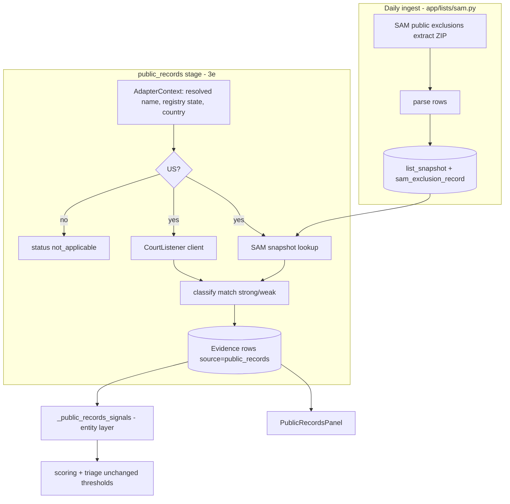

# Public Records Sources - Plan

## Goal Capsule

- **Objective:** Add a business-entity derogatory-records check to the KYB pipeline, built only on official free sources: CourtListener (bankruptcy and federal civil dockets) and SAM.gov exclusions. It is a new `public_records` stage whose findings raise entity-layer risk with cited evidence.
- **Authority:** This plan's Product Contract → `docs/spec.md` (origin) → `CLAUDE.md` §12 sensitive-surface rules. A conflict with CLAUDE.md §12 (no network in tests, never auto-approve, append-only audit, migrations on SQLite and Postgres) stops work.
- **Stop conditions:** Stop and file HITL if U1 finds that CourtListener's terms bar commercial use, or that neither the SAM extract nor the API is reachable with a non-federal account. Either finding changes scope (R11).
- **Execution profile:** TDD per CLAUDE.md §2. Write and review the RED test first for each feature-bearing unit. Commit per unit.
- **Tail ownership:** human merge only; the code-review agent runs to the merge bar.

---

## Product Contract

### Summary

A new Tier-1 pipeline stage searches federal court dockets and the SAM.gov exclusions list for the resolved business. It records each matched docket or exclusion as cited evidence and raises entity-layer risk for open bankruptcies, active federal exclusions, and repeated federal litigation as defendant. With no credentials or snapshot, it reports the sources unavailable and changes nothing.

### Problem Frame

The pipeline proves a business exists and is who it claims to be. It does not look at the business's derogatory public record, so a registered, OFAC-clean company in bankruptcy or under federal debarment can `pre_clear`. Operators check these sources by hand, outside the audit trail, or not at all. CLEAR was pitched to fill the gap, but the user chose to build on official free sources instead (see origin: docs/spec.md).

### Requirements

**Sources and access**
- R1. Search CourtListener for bankruptcy dockets naming the business as debtor and for open federal civil dockets naming it as a party.
- R2. Screen the business against a local snapshot of the SAM.gov public exclusions extract, matching by normalized name plus state (KTD10).
- R3. With no `COURTLISTENER_API_TOKEN`, CourtListener reports `unavailable`. With no SAM snapshot, SAM reports `unavailable`. Neither case emits evidence or signals, or changes the score.
- R4. A non-US submission records `not_applicable` and calls neither source.

**Evidence**
- R5. Each matched docket or exclusion is stored as one `public_records` evidence row carrying kind, status, dates, court/agency, docket number or SAM id, party name and role, match strength, and a source URL.
- R6. A record is a strong match only when the party name passes `names_match` and no state conflict exists under KTD10's per-source rules. SAM individual-classification rows are always `weak` in v1. Everything else is `weak`: stored and shown under "Possible matches", never scored.
- R7. Each run records a per-source status (`searched`, `no_records`, `unavailable`, `timeout`, `rate_limited`, `not_applicable`, `stale`) and a summary with true counts. Stored records are capped at 50 per category.

**Scoring**
- R8. Entity-layer elevated signals, on strong matches only:
  - `public_records_open_bankruptcy`: an open bankruptcy docket filed within 36 months. Weight 0.8.
  - `public_records_active_federal_exclusion`: an active SAM exclusion. Weight 0.9.
  - `public_records_federal_litigation_as_defendant`: three or more open federal civil cases as defendant. Weight 0.3.
- R9. Absence of records produces no trust signal.
- R10. `public_records_active_federal_exclusion` is added to `CRITICAL_ESCALATION_SIGNALS`, so it forces `escalate`. The bankruptcy and litigation signals are not critical (KTD11).
- R13. A CourtListener docket counts as open only when its last refresh is within 12 months. Older "open" dockets show as possible matches with an "out of date" note and never score (KTD13).
- R14. Personal data retention follows KTD12.

**Feasibility and display**
- R11. If CourtListener search results can't identify the party role, the litigation signal is dropped from v1 and cases are shown unscored.
- R12. The operator detail page shows a Public records panel in every state: strong matches, possible matches, no records, unavailable, not applicable, and stale snapshot.

### Acceptance Examples

- AE1. **Covers R8, R6.** Given a strong-match open Chapter 11 docket filed 14 months ago, when the run scores, then `public_records_open_bankruptcy` fires and its explanation cites the court, docket number, and filed date.
- AE2. **Covers R8.** Given an active firm-classification SAM exclusion whose name and state match the submission's, the exclusion signal fires, forces `escalate`, and cites the excluding agency and activation date. The same record with a past termination date fires nothing.
- AE3. **Covers R8, R11.** Three open cases as defendant fire the litigation signal. Two cases, three as plaintiff, or cases with unknown role fire nothing.
- AE4. **Covers R3, R9.** Unconfigured sources, and configured sources returning no records, both produce an overall score equal to a run without the stage.
- AE5. **Covers R6.** A Delaware bankruptcy docket for a Texas-registered company with a matching name is a strong match (court district is never a conflict). A docket whose debtor address state conflicts with the registry state appears under possible matches and fires nothing.

### Scope Boundaries

- People-finder scraping and people-data APIs: rejected (FCRA/ToS exposure, non-citable evidence).
- Criminal records and people screening: officers stay on the ADR-0006 bridge.
- State-court judgments, tax liens, and UCC filings: no free consolidated source. This is the documented coverage gap versus CLEAR.
- Paid PACER document purchases, monitoring/re-screening, PEP and adverse media (icebox IS3-T1).
- OpenSanctions and OpenCorporates: free keys but not free for business use.
- Phases 2–4 (CSL, regulatory enforcement, identity sources) are planned under Deferred to Follow-Up Work.

---

## Planning Contract

### Key Technical Decisions

- KTD1. **Build on official free sources, not CLEAR or people-finder scraping.** (session-settled: user-directed — chosen over people-finder scraping and EnformionGO: scraping requires bot-protection evasion, likely breaches ToS, and yields non-citable evidence with FCRA ambiguity.) Governs R1, R2.
- KTD2. **Use the SAM daily public extract ingested as a snapshot, not the per-entity Exclusions API.** A non-federal personal key without a role is limited to 10 requests/day, which a per-submission call would exhaust. The extract also gives point-in-time snapshots consistent with the OFAC pattern.
- KTD3. **Use a new `sam_exclusion_record` table linked to `list_snapshot`, not `watchlist_record`.** `watchlist_record` is shaped for persons (dobs, pobs, nationalities, gender) and lacks exclusion dates, UEI, and agency. It also feeds individual-screening monitoring, which SAM rows must not trigger. The table is added by an additive Alembic migration that runs on SQLite and Postgres.
- KTD4. **SAM ingest lives in its own module and CLI entry, reusing `record_snapshot`/`content_hash`, and is not added to `app/lists/ingest.SOURCES`.** That registry parses `PersonRecord`s and triggers `rescreen_for_snapshot`.
- KTD5. **One `public_records` stage with two injectable source clients, each with independent failure.** A CourtListener failure must not hide a SAM hit (R3). Phases 2–4 get their own adapters (see Deferred).
- KTD6. **Filter by `source`/`field` in scoring, never by tier.** Exclude `public_records` from the Tier-1 registry trust count and avoid early returns that would skip the new signals. This applies `docs/learnings/2026-09-24-new-source-tier-filters.md`.
- KTD7. **Match strength is decided in the adapter and stored on the evidence.** Scoring reads `match=strong` and never re-derives it. That keeps the explanation and the panel consistent with the scored evidence.
- KTD8. **No new dependencies.** Use the HTTP client already used by existing adapters and the stdlib `csv`/`zipfile`. Verify in U1.
- KTD9. **Place the stage at 3e, after `screen_people` and before `analyze_domain`.** Mirror that position in `test_pipeline_e2e.py` and `demo_data.py` for the stage-order guard.
- KTD10. **Match on name plus registry state; no UEI in v1.** (session-settled: user-approved — chosen over adding an optional UEI submission field: avoids a schema and API change now.) State comes from the resolved registry jurisdiction, with the billing-address state as fallback. A bankruptcy court's district never counts as a conflict. Only a debtor or party address state, or a SAM address state, can conflict. Governs R2, R6.
- KTD11. **An active federal exclusion forces escalation.** (session-settled: user-approved — chosen over raising weights or keeping all signals non-critical: at weight × 40 × 0.25 each signal adds only about 9 overall points, so a clean debarred company would still pre-clear.) This overrides the origin spec's "nothing critical" rule for this one signal. The operator still decides. Governs R10.
- KTD12. **Store all SAM classifications, keep the last 7 snapshots, and redact party names for integration API keys.** (session-settled: user-directed — chosen over storing firm rows only: individual exclusions stay available for later use.) Individual rows are stored but never strong-match a business in v1 (R6). Snapshots beyond the newest 7 are pruned with their rows. Recorded as an ADR-0002 addendum in U2. Governs R14.
- KTD13. **A docket counts as open only if refreshed within 12 months.** (session-settled: user-approved — chosen over 6 months or no freshness rule: CourtListener data refreshes only when someone fetches it, so old "open" dockets are often closed.) U1 confirms the refresh field. Governs R13.

### High-Level Technical Design

### Assumptions

- The pre-plan scoping confirmation was skipped because scope was settled across this session (spec plus two user decisions) and the user's standing instructions minimize interruptions. Inferred bets are listed here instead.
- Recency window (36 months), the litigation threshold (3 open cases), the 50-record cap, and the 7-day staleness threshold are starting values from the spec, tuned later on real runs.
- Federal civil cases come from CourtListener's existing RECAP docket metadata. Coverage is partial, which is why R9 forbids a trust signal on absence.

### Sources & Research

- CourtListener v4 search: `https://www.courtlistener.com/api/rest/v4/search/`, `type=d` for dockets, token in the `Authorization` header. Party filter syntax, bankruptcy court filter, rate limits, and commercial terms were not confirmed (U1).
- SAM Exclusions API v4 (`api.sam.gov/entity-information/v4/exclusions`): `exclusionName`, `ueiSAM`, a 10/day limit for non-federal personal keys without a role. Public exclusions extract via the SAM entity extracts API (`open.gsa.gov/api/sam-entity-extracts-api/`). Whether the download needs a key is unconfirmed (U1).
- Patterns: `backend/app/adapters/tax_id.py` (provider protocol, unconfigured default, `names_match`), `backend/app/lists/snapshot.py`, `backend/app/lists/ofac.py`, `backend/app/scoring/signals.py` (`_tax_id_signals`).

---

## Implementation Units

### U1. Verify source contracts and record fictional fixtures

- **Goal:** Confirm the CourtListener and SAM extract contracts the later units depend on, and capture fixture shapes.
- **Requirements:** R1, R2, R11
- **Dependencies:** none
- **Files:** `backend/tests/fixtures/public_records/courtlistener_*.json`, `backend/tests/fixtures/public_records/sam_exclusions_extract.csv`, `docs/implementation-notes.md`
- **Approach:**
  1. Using a real CourtListener token, confirm the party-name query syntax, the bankruptcy court filter, the fields returned (date filed and terminated, chapter, parties and roles), rate limits, and commercial-use terms.
  2. Confirm the SAM public extract download URL, whether it needs a key, file format, and column layout against `SAM_Exclusions_Public_Extract_Layout.pdf`.
  3. Build fixtures that copy the real response shapes but contain only fictional parties.
  4. Log findings and any R11 fallback in `docs/implementation-notes.md`.
- **Test expectation:** none — research and fixtures only. Fixtures are exercised by U2 and U3.
- **Verification:** implementation-notes records each confirmed contract or the R11/stop-condition outcome. Fixtures contain no real company or person.

### U2. Ingest the SAM public exclusions extract as a snapshot

- **Goal:** A CLI that downloads, parses, and snapshots the SAM extract into `sam_exclusion_record`.
- **Requirements:** R2, R7, R14
- **Dependencies:** U1
- **Files:** `backend/app/lists/sam.py`, `backend/app/models/sam_exclusion_record.py`, `backend/app/models/__init__.py`, `backend/app/db/migrations/versions/<new>_sam_exclusion_record.py`, `backend/tests/lists/test_sam.py`, `backend/tests/test_migrations.py`
- **Approach:** Follow KTD3 and KTD4. Each row stores the name, UEI, CAGE, state, classification, exclusion type, excluding agency, activation and termination dates, and SAM record id. Skip storing a new snapshot when the content hash is unchanged. A fetcher injected at the boundary keeps tests offline. Retention per KTD12: prune to the newest 7 snapshots, and add the ADR-0002 addendum.
- **Patterns to follow:** `backend/app/lists/ingest.py` (`ingest_source`), `backend/app/lists/snapshot.py`, `backend/app/models/watchlist_record.py`.
- **Test scenarios:**
  - The synthetic extract parses into the expected record count and fields.
  - Re-ingesting identical content creates no new snapshot (idempotent).
  - Changed content creates a new snapshot, and the earlier snapshot's rows are untouched.
  - A fetch failure is reported, and no snapshot or rows are written.
  - Malformed rows (missing name) are skipped and counted, not fatal.
  - The migration upgrades and downgrades on SQLite. A Postgres check runs where CI supports it.
- **Verification:** the CLI against the fixture yields one snapshot. The migration test passes.

### U3. public_records adapter and stage

- **Goal:** Query both sources, classify matches, and emit `public_records` evidence.
- **Requirements:** R1–R7, R11
- **Dependencies:** U1, U2
- **Files:** `backend/app/adapters/public_records.py`, `backend/tests/adapters/test_public_records.py`
- **Approach:**
  1. The CourtListener client is injectable, reads the token from the env, never logs it, and is wrapped in `RetryingAdapter`.
  2. SAM lookup reads the latest snapshot and matches `core_name` plus state (KTD10).
  3. Classify each record per R6 and KTD7.
  4. Emit status, summary, and record rows per R5 and R7. Each source succeeds or fails on its own (KTD5).
- **Execution note:** Implement test-first. The RED adapter tests are the spec and get reviewed before code.
- **Patterns to follow:** `backend/app/adapters/tax_id.py` (provider protocol, `UnconfiguredTaxIdProvider`, `names_match`, failure mapping), `backend/app/adapters/sanctions.py` (`SanctionsScreeningStage`).
- **Test scenarios:**
  - Covers AE4. With no token and no snapshot, both sources are `unavailable` and no record rows exist.
  - A CourtListener open Chapter 11 fixture yields a strong `bankruptcy` record with court, docket number, filed date, and source URL.
  - Covers AE5. A Delaware-venue bankruptcy for a Texas-registered company stays strong. A debtor-address state conflict yields `match=weak`.
  - A SAM firm row matching name and registry state yields strong. An individual-class row with the same name yields weak.
  - With no registry state, the billing-address state is used. With neither, an exact name match is strong only for CourtListener, and SAM stays weak.
  - A docket last refreshed 13 months ago with no termination date yields weak with an `out_of_date` flag.
  - CourtListener `TimeoutError` → `timeout`, HTTP 429 → `rate_limited`, any other error → `unavailable`. A SAM hit in the same run is still emitted.
  - A non-US country records `not_applicable`, and both injected clients record zero calls.
  - A snapshot older than 7 days is used, with a `stale` status row.
  - 60 dockets in a category store 50, most recent first, and the summary reports 60.
  - Party role missing from results → cases stored with `role=unknown` (R11).
- **Verification:** the adapter suite is green with no network access.

### U4. Entity-layer scoring signals

- **Goal:** Turn strong-match evidence into the three R8 signals with cited explanations.
- **Requirements:** R8, R9, R10
- **Dependencies:** U3
- **Files:** `backend/app/scoring/signals.py`, `backend/app/scoring/explain.py` (if signal text lives there), `backend/tests/scoring/test_public_records_signals.py`
- **Approach:** Add `_public_records_signals()` called from `entity_legitimacy_signals` on every path (KTD6). Exclude `public_records` from the Tier-1 registry filter near the existing `tax_id` exclusion.
- **Execution note:** Test-first. Include the regression tests the tier-filter learning prescribes.
- **Patterns to follow:** `_tax_id_signals` and `backend/tests/scoring/test_tax_id_signals.py`.
- **Test scenarios:**
  - Covers AE1. An open bankruptcy filed 14 months ago fires at weight 0.8 and cites court, docket, and date. One filed 40 months ago, or a discharged one, fires nothing.
  - Covers AE2. An active exclusion fires at 0.9 and forces `escalate` through the critical-signal path. A terminated one fires nothing.
  - Covers AE3. The litigation threshold and role handling.
  - Weak records never fire.
  - Covers AE4. `no_records` evidence yields a score equal to no evidence (no trust signal).
  - Only `public_records_active_federal_exclusion` is in `CRITICAL_ESCALATION_SIGNALS`. Triage has a test per tier: a clean company with the exclusion escalates, and one with only a bankruptcy keeps its score-based tier.
  - Registry signals are unchanged when `public_records` rows are added.
  - Public-records signals still fire when registry evidence is missing.
- **Verification:** the scoring suite is green and existing scoring tests are unchanged.

### U5. Pipeline wiring and demo seed

- **Goal:** Run the stage in the real pipeline and show it on one fictional demo company.
- **Requirements:** R3, R8
- **Dependencies:** U3, U4
- **Files:** `backend/app/pipeline/orchestrator.py`, `backend/tests/pipeline/test_pipeline_e2e.py`, `backend/app/demo_data.py`, `docs/ARCHITECTURE.md`, `docs/RUNBOOK.md`
- **Approach:** Insert at 3e per KTD9. The demo seed injects fixture-backed clients for one designated company and an empty result for the others. RUNBOOK documents `COURTLISTENER_API_TOKEN` and the SAM ingest command. ARCHITECTURE's sources table gets the new rows.
- **Patterns to follow:** how `VerifyTaxIdStage` is injected with `StubTaxIdProvider` in `demo_data.py`.
- **Test scenarios:**
  - The stage-order guard passes with `public_records` at 3e in all three places.
  - An e2e run with an unconfigured stage produces the same tiers and scores as before for every scenario.
  - The designated demo company moves out of `pre_clear`. Every other demo company keeps its tier.
- **Verification:** the full backend gate is green. Before/after tiers and scores recorded in implementation-notes show only the designated company changed.

### U6. Public records panel in the operator UI

- **Goal:** Show public-records evidence on the company detail page in every state.
- **Requirements:** R12
- **Dependencies:** U3 (evidence shape). Can proceed in parallel with U4 and U5.
- **Files:** `frontend/src/components/PublicRecordsPanel.tsx`, `frontend/src/components/PublicRecordsPanel.test.tsx`, `frontend/src/components/DetailPanels.tsx`, `frontend/src/api/client.ts`
- **Approach:** Group strong matches by kind, list weak matches under "Possible matches", and show per-source status (unavailable, not applicable, no records, stale with snapshot date). Each record links to its source URL.
- **Patterns to follow:** existing panels in `DetailPanels.tsx` (tax-ID and sanctions evidence rendering).
- **Test scenarios:**
  - Strong matches render grouped by kind with docket number and link.
  - Weak matches render only under "Possible matches".
  - The no records, unavailable, not applicable, and stale states each render their message.
  - Mixed status (CourtListener unavailable, SAM hit) renders both.
- **Verification:** `npm run lint && npm run test && npm run build` are green, and a manual demo check shows the designated company's panel.

---

## Deferred to Follow-Up Work

Each unit below becomes its own adapter, except U7, which extends `sanctions_screening`. Every one reuses R3, R6, R9, and R10 and fictional fixtures. Each starts by confirming endpoint, auth, rate limits, and commercial terms against official docs. Items marked † were found only in third-party documentation as of 2026-10-16.

### U7. Add trade.gov Consolidated Screening List to sanctions screening

- **Goal:** Screen businesses against the 11 US export-control and sanctions lists in the CSL.
- **Requirements:** extends existing sanctions screening (P2-T3)
- **Dependencies:** none on U1–U6
- **Files:** `backend/app/lists/csl.py`, `backend/app/adapters/sanctions.py`, `backend/tests/lists/test_csl.py`, `backend/tests/adapters/test_sanctions.py`
- **Approach:** Ingest the keyless downloadable CSV/JSON as a snapshot. A hit flows through the existing `sanctions_hit` path, and the evidence names the specific list. The free-key search API (key format †) is the fallback.
- **Test scenarios:**
  - A synthetic CSL entry matching the company name fires `sanctions_hit` and names the list.
  - Re-ingesting unchanged content is a no-op.
  - Without a CSL snapshot, the existing OFAC behavior is unchanged.
- **Verification:** sanctions tests are green, and the demo sanctions scenario is unchanged.

### U8. EPA ECHO enforcement adapter

- **Goal:** Record environmental formal enforcement actions against the business.
- **Requirements:** R3, R6, R9 pattern
- **Dependencies:** U3 (shared match helpers)
- **Files:** `backend/app/adapters/epa_echo.py`, `backend/tests/adapters/test_epa_echo.py`, `backend/app/scoring/signals.py`
- **Approach:** Keyless REST with two-step QID pagination. A low-weight elevated signal fires only for formal enforcement within 5 years.
- **Test scenarios:**
  - A formal action 2 years ago fires the signal.
  - An informal action or one 6 years ago fires nothing.
  - QID pagination assembles all pages from the fixture.
  - Timeout → `unavailable`.
- **Verification:** the adapter and scoring suites are green, and no other signals are affected.

### U9. DOL Wage & Hour enforcement adapter

- **Goal:** Record concluded wage-and-hour compliance actions against the business.
- **Requirements:** R3, R6, R9 pattern
- **Dependencies:** U3
- **Files:** `backend/app/adapters/dol_whd.py`, `backend/tests/adapters/test_dol_whd.py`, `backend/app/scoring/signals.py`
- **Approach:** Free key passed as a query parameter †, registered at the DOL data portal †. A low-weight signal fires on repeat or willful findings or back wages above a threshold set in the ticket.
- **Test scenarios:**
  - A repeat-violator fixture fires the signal.
  - A single minor finding fires nothing.
  - A missing key → `unavailable`.
  - The key never appears in logs.
- **Verification:** suites green.

### U10. CFPB consumer complaints adapter

- **Goal:** Show consumer-complaint context for financial-services submissions.
- **Requirements:** R3, R9 pattern
- **Dependencies:** U3
- **Files:** `backend/app/adapters/cfpb.py`, `backend/tests/adapters/test_cfpb.py`
- **Approach:** Keyless †. Runs only when the submission's industry is financial services. Shows complaint volume and untimely-response rate, with weight ≤0.2. Institutions under $10B in assets aren't published, so absence is never a signal.
- **Test scenarios:**
  - A non-financial industry is skipped with zero calls.
  - A high untimely-response fixture fires the low-weight signal.
  - An empty result → `no_records` with no trust signal.
- **Verification:** suites green.

### U11. GLEIF LEI identity and ownership corroboration

- **Goal:** Corroborate legal identity and parent entities via LEI records.
- **Requirements:** feeds entity resolution and ownership, not derogatory scoring
- **Dependencies:** none on U1–U6
- **Files:** `backend/app/adapters/gleif.py`, `backend/app/pipeline/resolve.py`, `backend/app/pipeline/ownership.py`, `backend/tests/adapters/test_gleif.py`
- **Approach:** Keyless JSON:API † with CC0 data †. An exact LEI legal-name and address match is a Tier-1 corroborating trust signal. Direct and ultimate parents feed the ownership graph.
- **Test scenarios:**
  - An exact legal-name and jurisdiction match yields a trust signal.
  - A fuzzy-only match yields no signal.
  - Parent relationships appear in the ownership output.
  - The registry-signal regression from the tier-filter learning holds.
- **Verification:** suites green.

### U12. SEC EDGAR filer corroboration

- **Goal:** Corroborate identity for public companies and flag delinquent or revoked filers.
- **Requirements:** identity corroboration
- **Dependencies:** U11 (shared corroboration signal shape)
- **Files:** `backend/app/adapters/sec_edgar.py`, `backend/tests/adapters/test_sec_edgar.py`
- **Approach:** Keyless, with a required descriptive User-Agent including a contact email. A client-side throttle stays under 10 requests/second. Runs only when the name resolves to a CIK.
- **Test scenarios:**
  - A resolved CIK yields filer identity evidence.
  - No CIK → skipped with zero further calls.
  - The throttle spaces calls in a fixture burst.
  - A 403 or 429 → `rate_limited`.
- **Verification:** suites green.

---

## System-Wide Impact

- **Scoring:** entity-layer scores rise for companies with derogatory records. Triage thresholds and critical signals are unchanged (R10).
- **Data:** one new append-only table (`sam_exclusion_record`) and new evidence rows. Party names on sole-proprietor dockets may be personal names, so ADR-0002 retention applies to evidence as it does today.
- **Operations:** a new daily SAM ingest job alongside the sanctions list ingest, and one new secret (`COURTLISTENER_API_TOKEN`).

## Risks & Dependencies

| Risk | Mitigation |
|---|---|
| CourtListener terms bar commercial use, or the party filter is unavailable | U1 stop condition. R11 fallback to bankruptcy only. |
| SAM extract requires an account role we can't get | U1 stop condition. The 10/day API is not a viable substitute (KTD2). |
| Name collisions inflate false positives | Strong-match rule (R6). Weak matches never score. |
| A new Tier-1 source shifts existing signals | KTD6 plus the regression tests in U4. |

---

## Open Questions

OQ1–OQ4 from the 2026-10-16 doc review were resolved the same day as KTD11 (OQ1), KTD10 (OQ2), KTD12 (OQ3), and KTD13 (OQ4). None remain open.

---

## Verification Contract

| Gate | Command | Applies to |
|---|---|---|
| Backend lint/format/tests | `cd backend && .venv/bin/ruff check . && .venv/bin/ruff format --check . && .venv/bin/pytest -q` | U2–U5, U7–U12 |
| Frontend | `cd frontend && npm run lint && npm run test && npm run build` | U6 |
| Migration | `backend/tests/test_migrations.py` on SQLite; Postgres where available | U2 |
| Regression | before/after demo tiers and scores recorded in implementation-notes | U5 |
| Review | code-review agent: approve + tests pass + no ≥medium findings | every PR |

## Definition of Done

- U1–U6 merged by a human, each feature-bearing unit with its RED test reviewed before implementation.
- With no token and no snapshot, every demo company other than the designated public-records company keeps the score and tier it had on `main` before this work.
- No real company or person data in fixtures or commits. No network access in tests.
- `docs/implementation-notes.md` records the U1 findings, the coverage gap, and every deviation.
- Abandoned or experimental code is removed from the diff.
- U7–U12 exist as `horizon: future` tickets and are not started.
